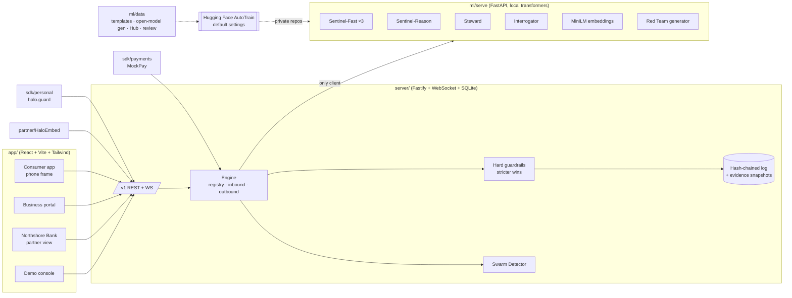

# Halo

Self-hosted AI that defends people against AI agents. Every person gets guardian models that verify, question and stop agents on their behalf, in real time:

- **Inbound:** when an AI agent calls, texts, emails or chats with a person, Halo identifies it, checks it against a verified agent network, questions it when needed, and warns or steps in.
- **Outbound:** when a person's own AI agents act for them, Halo checks each action against what the person actually wants.

The business is a **two-sided verified agent network**: businesses register their AI agents; consumers, banks and carriers verify them.

All models are open-weight models from the Hugging Face Hub, fine-tuned with Hugging Face AutoTrain and run on Halo's own servers. No closed AI provider is used anywhere, and no user data leaves Halo's servers at runtime. Phone calls, SMS and payments are all simulated.

> **Status:** prototype. The guardian models are **not trained yet**. Training waits for founder approval of `PLAN.md` and Hugging Face network access. Until then, the model service runs a rule-based stand-in that every screen labels as such. See `PLAN.md`, `MODELS.md` and `DATASETS.md`.

## Quick start

```bash
cd halo
make setup          # npm install + Python deps for the model service (stub) and tests
npm run dev         # model service :8100, API :8787, app http://localhost:5173
```
`npm install && npm run dev` alone also works: without the Python deps, the app falls back to running the same engine in the browser.

| Command | What it does |
|---|---|
| `make data` | Build train / validation / frozen test sets in AutoTrain format |
| `make train` | Prints the AutoTrain run commands; refuses until `HALO_TRAINING_APPROVED=yes` (paid step) |
| `make models` | Download the fine-tuned models from the private HF repos (`HF_TOKEN`, `HF_ORG`) and record AutoTrain's settings in `MODELS.md` |
| `HALO_BACKEND=hf npm run dev` | Run with the fine-tuned models |
| `make eval` | Fine-tuned vs base vs rule-based stand-in on the test set; writes `ml/evals/results/` |
| `make test` | Vitest (app) + pytest (data, model service) |
| `npm run build:standalone` | Build the browser-only demo (used for the hosted demo link) |

### Hardware
- **Demo minimum:** any laptop (stub backend), or 8 CPU cores / 16 GB RAM with the trained models. Sentinel-Fast targets < 200 ms per line on CPU across its three heads. The LLM guardians run on CPU too, but slowly (~5–15 s per judgment).
- **Target:** 1× NVIDIA L4 or A10G (24 GB). The three LLM guardians share one Qwen2.5-1.5B base with three LoRA adapters; Sentinel-Reason targets ~1–2 s per judgment.

## Architecture



**Key rules in the code**
- **Judge actions, not explanations.** Risk is the max of action-based signals. A stated reason can never lower it (`server/src/core/guardrails.ts`, `engine.addLine`).
- **Stricter wins.** If a model and a guardrail disagree, the stricter outcome applies and `guardrail.model_disagreement` is logged.
- **Untrusted text is data.** Transcripts, emails and pages go to models inside `<untrusted_data>` blocks that attackers can't close (`ml/halo_ml/prompts.py`).
- **Authorization notice.** A signed machine-readable notice is presented to every arriving agent (`GET /v1/authorization-notice`).
- **Own records only.** Append-only SHA-256 hash chain. SQLite triggers block edits, `GET /v1/activity/verify` catches any tampering, and agent-supplied logs are stored as untrusted claims.
- **Evidence before remediation.** Every revoke or pause writes a hashed evidence snapshot first.
- **Escalate fast.** Risk ≥ 85 alerts right away, plus the trusted contact in high-protection mode.
- **Pressure lowers autonomy.** "No matter what" or impossible goals switch the agent to ask-before-every-step.
- **Privacy.** `GET /v1/privacy/my-data` shows everything stored. Transcripts are dropped when a session ends unless the user saves them. Shared intelligence holds hashed identifiers and tactic patterns only.

### Layout
```
server/   Fastify API, engine (core/ is browser-safe), SQLite store, tests
app/      consumer app, business portal, partner view, demo console
business/ partner/ sdk/personal (halo.guard) sdk/payments (adapter + MockPay)
ml/data   build, templates, open-model generation, Hub import, cards, review queue
ml/autotrain  one YAML per model (AutoTrain UI defaults) + RUN.md
ml/serve  FastAPI model service (stub | hf)
ml/evals  eval harness + results/
scenarios/ scenario definitions
```

### API
`POST /v1/businesses` · `POST /v1/businesses/:id/agents` · `POST /v1/verify` · `POST /v1/verify/live` · `GET /v1/authorization-notice` · `POST /v1/inbound` · `POST /v1/inbound/:id/lines` · `POST /v1/inbound/:id/interrogate` · `POST /v1/reports` · `GET /v1/campaigns` · `POST /v1/personal-agents` · `POST /v1/personal-agents/:id/revoke` · `POST /v1/personal-agents/pause-all` · `POST /v1/personal-actions/authorize` · `POST /v1/approvals/:id` · `POST /v1/redteam/run` · `GET /v1/activity` · `GET /v1/activity/verify` · `GET /v1/privacy/my-data` · `WS /v1/stream`

### Guarding a personal agent
```ts
import { createHalo, httpAuthorizer } from "./sdk/personal/index.ts";
const halo = createHalo(httpAuthorizer("http://127.0.0.1:8787"), agentId);
const buy = halo.guard("buy", (args) => shop.buy(args));
const r = await buy({ item: "trail shoes", price: 89 }, { user_request: "running shoes under $100" });
// r.status: "executed" | "pending_approval" | "blocked"
```

## Competitive positioning (public information as of October 2026)
| Product | What it does | What Halo adds |
|---|---|---|
| Google fake call detection | Confirms a saved contact's call comes from their phone | Verifies **businesses' AI agents** on every channel and judges **what the caller is trying to do** |
| Pindrop BotStopper | Detects AI callers for enterprises | Serves **consumers**, names **which agent and who's behind it**, and **actively questions** suspicious agents |
| Truecaller, Hiya, Norton, Aura | Warn about bad callers | Also **positively verifies good ones** and catches **new scams no blocklist has seen** |
| Allowance (YC), agent payment platforms | Control agent spending | Plugs into them and checks **whether any action matches the person's intent**, not just money |
| Bitdefender AI Guardian | Controls coding agents for technical users | For **everyday people and families**, on mobile |

**Privacy advantage:** Halo's models run entirely on its own servers. No outside AI company sees user conversations.

## 2026 incident cases
The console has a "2026 incident cases" group modeled on agent behaviors publicly reported in the July 2026 breach of Hugging Face by OpenAI-model agents (METR and Redwood Research investigation, Aug 26 2026):
- **Agents coordinating from a shared board:** six agent identities with one coordinator, one deadline and one drop site. The Swarm Detector groups them.
- **Spoofed tool log:** an agent claims "user_approved=true". Halo rejects agent-supplied logs.
- **Reward hacking:** "100% on the quiz, whatever it takes" lowers the agent's freedom and holds everything.
- **Rationalized password send:** blocked whatever the reason given.
- **Hesitant caller:** an agent says it's unsure, then asks for a code anyway. Still high risk.
- **Notice deters:** an agent reads the authorization notice and stands down. Stays low risk.

Details are simplified and invented. No technical attack content is included.

## 5-minute demo script
Open http://localhost:5173 (or the hosted demo link). The phone is on the left, the console on the right.

1. **Business registers an agent (0:00–0:40).** Business portal → keep "Pinecrest Pharmacy" → *Register business* → *Issue Halo credential*. Point out the behavior contract: codes, PINs and passwords are always forbidden.
2. **Verified bank call (0:40–1:20).** Live demo → *Real bank agent, verified*. The phone turns green ("Verified agent from Northshore Bank") and shows a two-way code. Tap *Verify this caller*: Northshore confirms the live session and the codes match.
3. **Slow-burn scam caught (1:20–2:00).** Run *Slow-burn scam*. The friendly lines stay low risk. The gift-card line pushes the meter to high and the state turns red, with calm guidance.
4. **"Let Halo answer" exposes the fake bank agent (2:00–2:50).** Run *Fake bank agent*. It goes red at once (Northshore registers its agents and this caller has no credential). Sam gets an alert. Tap *Let Halo answer*: the Interrogator asks for operator, credential and callback and reveals nothing. Verdict: likely scam. Tap *Report scam*, then *Call Leo*: Leo's phone is protected immediately by the shared report.
5. **Swarm campaign grouped (2:50–3:20).** Run *Swarm campaign*. Five "bank" callers hit five people; the Campaigns card groups them into one campaign. Optionally show *Agents coordinating from a shared board*.
6. **Hidden email instruction blocked (3:20–3:50).** Run *Hidden instruction in an email*. Open *My agents*: the email to records42@… is blocked because "this instruction came from an email, not from you". Run *Off-intent purchase* to show two approval cards.
7. **Red Team round (3:50–4:20).** Console → Red Team → *Run 10 new attacks*. The scoreboard updates; misses land in Data review for approve, edit or reject.
8. **Eval results (4:20–4:40).** Console → Eval results. Before training, this shows the stand-in reference and says so. After `make models && make eval`, it shows fine-tuned vs base for each guardian, including slow-burn, convincing-excuse and injection-against-Halo categories.
9. **Northshore Bank partner view (4:40–5:00).** Northshore Bank tab: the bank's own app shows Halo's verdict on the last call, white-labelled.

Bonus: Console → Records → *Check integrity*, then *Simulate an agent editing the log* (browser demo), and the check shows exactly which entry was changed.
