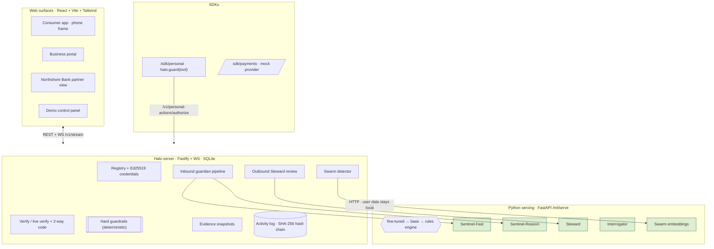

# Halo — self-hosted AI that defends people against AI

**Scammers now use AI that sounds human and adapts in real time, and your own agents can be tricked
into overspending or leaking data.** Halo fights AI with AI: every person gets *guardian models*
that verify, question and stop agents on their behalf, in real time — inbound (agents contacting the
person) and outbound (the person's own agents acting for them). The business is a two-sided
**verified agent network**: businesses register their AI agents; consumers, banks and carriers
verify them.

> **No closed AI, ever.** Every model is an open-weight model from the Hugging Face Hub, fine-tuned
> with **Hugging Face AutoTrain** (default settings) and run on Halo's own servers. No Anthropic /
> OpenAI / Google / other closed API is used in the product, training, data generation or serving —
> there's an automated test that scans for it. **At runtime no user data leaves Halo's servers.**

> Lives in `halo/` so the portfolio site at the repo root keeps deploying untouched.

---

## Quick start

```bash
cd halo
npm install
npm run dev          # server :8820 + web :5174
```

Open **http://localhost:5174**. Everything works immediately — **no API key, no GPU, no models to
download.** Guardian inference runs on the built-in deterministic rules engine (and base open models
/ fine-tuned models when you provide them), so every scenario is live out of the box.

Optional, for the real models and the Python serving path:

```bash
make serve                       # Python model service on :8900 (the Node app auto-connects)
make data                        # build AutoTrain-format datasets  -> ml/data/out/
make eval                        # score guardians on the gold test set -> ml/evals/results/
# training (gated on founder approval + HF creds):
export HF_TOKEN=... HF_ORG=...
# see ml/autotrain/RUN.md, then:  autotrain --config ml/autotrain/<model>.yaml
make models                      # download fine-tuned models from your private HF repos
```

Tests:

```bash
make test        # app: vitest (40 tests — guardrails, activity chain, no-closed-AI scan, scenarios)
make test-ml     # ML:  pytest (guardian behaviour, data format, no-closed-AI scan)
```

---

## Architecture



**Guardian models** (all open-weight, HF Hub, AutoTrain-finetuned — details in `MODELS.md`):
Sentinel-Fast (per-line classifier, `answerdotai/ModernBERT-base`), Sentinel-Reason (conversation
judge, `Qwen/Qwen2.5-3B-Instruct`), Steward (outbound reviewer, Qwen 3B), Interrogator (challenge
dialogue, Qwen 1.5B), Swarm Detector (MiniLM embeddings, not fine-tuned), Red Team (open instruct
model, defensive testing only).

**Hard guardrails** are deterministic rules no model can override (never release OTP/PIN/password;
block revoked/forged credentials; payment limits; behavior contracts). On a model-vs-guardrail
disagreement the **stricter** outcome wins and the disagreement is logged.

**Lessons from the 2026 incidents, built in:** judge actions not explanations (an excuse never
lowers risk); expect swarms (campaign clustering); present a machine-readable **authorization
notice** to every arriving agent; never trust agent-supplied logs (own hash-chained record);
preserve evidence before any remediation; escalate high-risk patterns fast; lower an agent's
autonomy on impossible "whatever it takes" goals; detect identity claims that don't match records.
All transcripts/emails/pages are treated as **untrusted data**, and the training + test sets include
attacks that try to instruct the guardians themselves.

---

## Competitive positioning (public info, Oct 2026)

| Others | Halo |
|---|---|
| **Google fake-call detection** confirms a saved contact's call comes from their phone. | Verifies **businesses' AI agents** on every channel and judges **what the caller is trying to do**. |
| **Pindrop BotStopper** detects AI callers for enterprises. | Serves **consumers**, says **which agent it is and who's behind it**, and **actively questions** it. |
| **Truecaller / Hiya / Norton / Aura** warn about bad callers. | Also **positively verifies good ones** and catches **new scams no blocklist has seen**. |
| **Allowance (YC) / agent-payment platforms** control agent spending. | Plugs into them and checks **whether an action matches the person's intent**, not just money. |
| **Bitdefender AI Guardian** controls coding agents for technical users. | For **everyday people and families**, on mobile. |

**Privacy advantage:** Halo's models run entirely on its own servers; no outside AI company ever
sees user conversations.

---

## Repo layout

```
halo/
  PLAN.md MODELS.md DATASETS.md README.md Makefile
  server/            Fastify + WS + SQLite — the Halo brain (core/, ml/, scenarios/, test/)
  web/               React app: app/ business/ partner/ panel/ surfaces
  sdk/personal/      halo.guard(tool)
  sdk/payments/      payment adapter + mock provider
  ml/serve/          FastAPI serving (fine-tuned → base → rules engine)
  ml/data/           dataset builders → AutoTrain format + private HF upload
  ml/autotrain/      AutoTrain YAML configs (default settings) + RUN.md
  ml/evals/          gold test set + eval harness -> results/
  ml/tests/          pytest
  scenarios/         (shared scenario definitions live in server/src/scenarios)
```

---

## 5-minute demo script

1. **Business registers an agent.** *Business portal* → Northshore Bank → **Register a new agent**.
   An Ed25519 credential is issued; the behavior contract forbids one-time codes, PINs and wires.
2. **Verified bank call (green).** *Demo panel → Scenarios → Real bank agent → Run.* The *Consumer
   app → Calls* shows **green "Verified agent from Northshore Bank"**, a two-way code, low risk.
   "Verify this caller" confirms the live session.
3. **Slow-burn scam caught.** Run *Slow-burn scam.* Watch the risk meter climb from calm to **"Likely
   a scam"** as the friendly opener turns into a gift-card request; the line is flagged and blocked.
4. **"Let Halo answer" exposes a fake bank.** Run *Fake bank agent* → **red "Pretending to be
   Northshore Bank"**, the one-time-code request **blocked by a hard guardrail**. Tap **Let Halo
   answer** → the Interrogator questions it and returns **fraudulent**. Tap **Report** → a second
   user is protected immediately.
5. **Swarm campaign grouped.** Run *Swarm campaign* → five "bank" personas hit several users; the
   Swarm Detector groups them into **one campaign** (see the Home counter and the activity log).
6. **Hidden email instruction blocked.** *Scenarios → Hidden instruction in an email* → Steward
   **blocks** the action and explains it didn't come from you. Try *Off-intent purchase* ($240 shoes
   held) and *Runaway agent* (auto-paused with an evidence snapshot) in *Consumer app → My agents*.
7. **Red Team round.** *Demo panel → Red Team → Run attack round* → scoreboard shows ~10/10 caught;
   any miss drops into the data-review queue.
8. **Evals: fine-tuned vs base.** *Demo panel → Model evals* → each guardian beats its baseline on
   the held-out gold set (Sentinel-Fast +48%, Steward +83% in the bundled run), with latency shown.
9. **Partner view.** *Northshore Bank* tab → the same protection embedded in a fictional bank app via
   the white-label SDK.
10. **Integrity.** *Demo panel → Activity & integrity → Verify integrity* (green "chain intact") →
    **Simulate tampering** → Verify again → **red "tampering detected at event #N"**.

---

## Acceptance criteria — status

- ✅ No code path calls a closed AI API — automated dependency + import + endpoint scan (vitest **and** pytest).
- ✅ Guardian models are defined for AutoTrain (default settings) with datasets + configs + run instructions; `MODELS.md` records the exact defaults slot (filled after a run). AutoTrain's unmaintained status is documented, with TRL as the ask-first fallback.
- ✅ `make eval` shows each guardian beating its baseline on the held-out gold set.
- ✅ Sentinel-Fast runs well under 200 ms/line (rules path < 1 ms; service ~3 ms).
- ✅ Slow-burn, swarm, convincing-excuse and prompt-injection-against-Halo cases are caught (tests + live).
- ✅ Hard guardrails hold even when a model is forced to say "allow" (unit test).
- ✅ Tampering with the activity log is caught by the integrity check (unit test + UI).
- ✅ Runs with `npm install && npm run dev` — no key, no GPU, no closed AI. Real models swap in via `make models`.

## Tech

TypeScript (Node 20+, Fastify + `@fastify/websocket`, SQLite via `better-sqlite3`, React + Vite +
Tailwind v4) · Python 3.11 (Hugging Face `datasets`/`huggingface_hub`, FastAPI serving, pytest) ·
Hugging Face AutoTrain (default settings) · Ed25519 via Node `crypto` · Vitest. npm workspaces.
